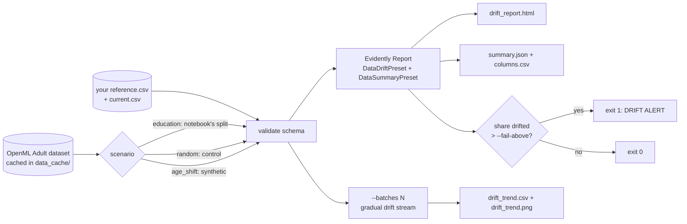
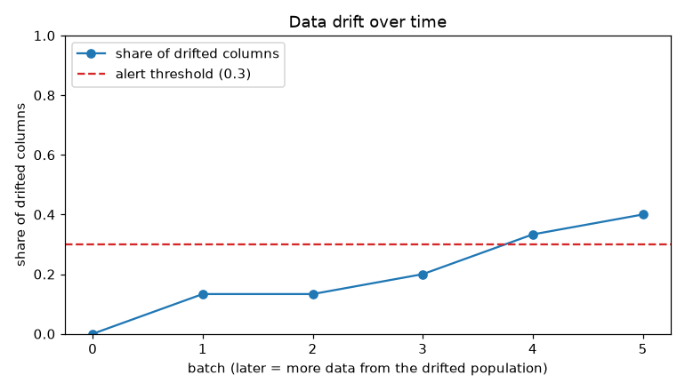
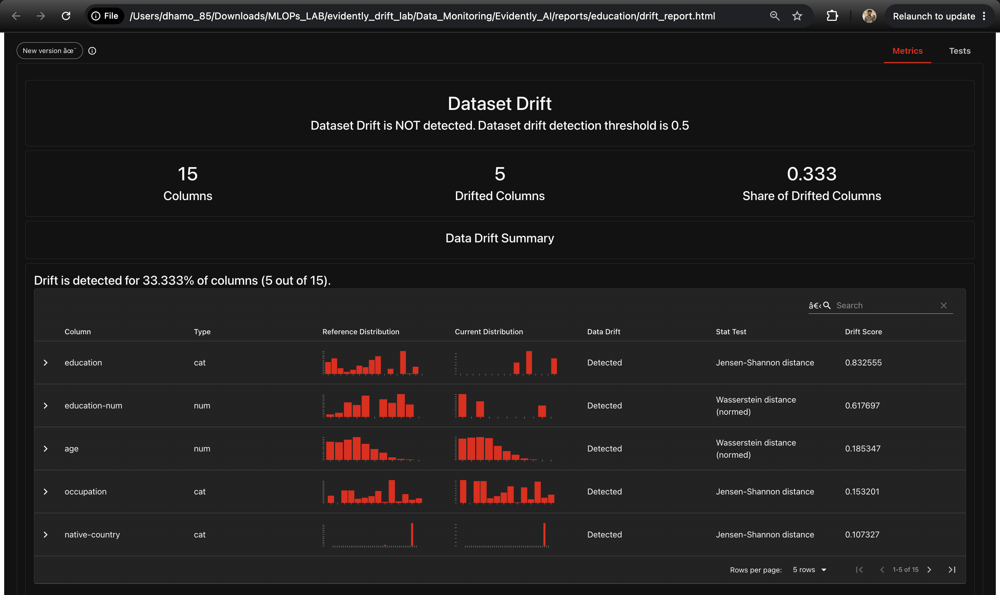
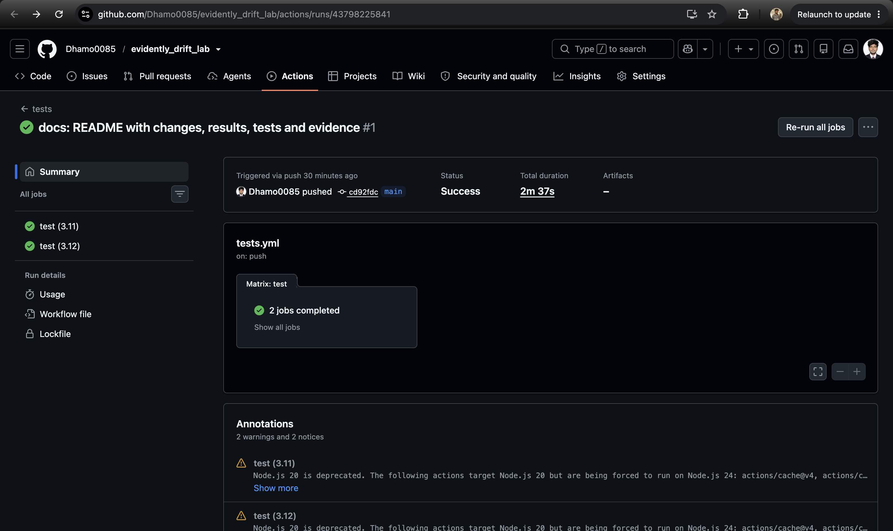

# evidently_drift_lab

[](https://github.com/Dhamo0085/evidently_drift_lab/actions/workflows/tests.yml)


> **Submission:** this is a single submission of the course's **Data Monitoring lab with Evidently AI** (`Labs/Data_Labs/Data_Monitoring/Evidently_AI`).

This repo extends the **Evidently AI data-drift lab** from Prof. Ramin Mohammadi's **MLOps course** (DADS 7305 / IE 7374, Northeastern University). In the original notebook, the UCI Adult census data is split into a "reference" and a "production" set by education level, and an Evidently `DataDriftPreset` report is shown inline.

I kept that analysis unchanged; its result is reproduced exactly (5 of 15 columns drift, same scores). I fixed 7 problems, including a **leaked API token** and an install that **no longer works today**. On top of that I added:

- `drift_monitor.py`, a reusable drift monitor with a **no-drift control** and a synthetic-drift scenario;
- a **CI drift gate** (exit code 1 when too many columns drift);
- **batch monitoring over time** with a trend chart;
- **47 tests** (the original had none) and GitHub Actions CI.

Original lab: [raminmohammadi/MLOps → Labs/Data_Labs/Data_Monitoring/Evidently_AI](https://github.com/raminmohammadi/MLOps/tree/main/Labs/Data_Labs/Data_Monitoring/Evidently_AI).

---

## Contents

1. [How it fits together](#1-how-it-fits-together)
2. [Quick start](#2-quick-start)
3. [Verify the changes yourself](#3-verify-the-changes-yourself)
4. [What I changed](#4-what-i-changed)
5. [Results](#5-results)
6. [Testing](#6-testing)
7. [Project structure](#7-project-structure)
8. [Screenshots](#8-screenshots)
9. [Design decisions](#9-design-decisions)
10. [Limitations and future work](#10-limitations-and-future-work)
11. [Credits](#11-credits)

---

## 1. How it fits together



---

## 2. Quick start

You need Python **3.11 or 3.12** (both tested locally on macOS: 3.11.10 and 3.12.14). Python 3.13 is not supported, because `evidently==0.7.0` requires `numpy<2.1`, which has no 3.13 builds.

```bash
git clone https://github.com/Dhamo0085/evidently_drift_lab.git
cd evidently_drift_lab
python3.12 -m venv .venv
source .venv/bin/activate          # Windows: .venv\Scripts\activate
pip install -r requirements.txt
cd Data_Monitoring/Evidently_AI
```

```bash
python drift_monitor.py                                   # the notebook's scenario; downloads Adult once (~12 s)
python drift_monitor.py --scenario random                 # control: expect 0 drifted columns
python drift_monitor.py --scenario age_shift              # synthetic: only "age" should drift
python drift_monitor.py --fail-above 0.3 --batches 6      # CI gate + drift-over-time chart
open reports/education/drift_report.html                  # macOS; on Windows: start ...
```

The original notebook (`Lab1.ipynb`) still works in Jupyter. The Evidently Cloud upload is now optional: set `EVIDENTLY_API_TOKEN` in your shell to use it.

| Option | Meaning |
|---|---|
| `--scenario education\|random\|age_shift` | How reference/current are built from the Adult data (default `education`, the notebook's split) |
| `--reference a.csv --current b.csv` | Monitor your own data; schema inferred from dtypes, or `--num-cols ... --cat-cols ...` |
| `--fail-above SHARE` | Exit code **1** if more than SHARE (0–1) of the columns drift; use it as a CI/production gate |
| `--batches N [--batch-size 2000]` | Simulate N batches of gradually increasing drift; writes a trend CSV and chart |
| `--out DIR` | Output folder (default `reports/`) |

Exit codes: **0** OK · **1** drift gate breached · **2** bad input (missing columns, empty data, bad options).

Run the tests from the repo root:

```bash
pytest -q
```

---

## 3. Verify the changes yourself

The first commit is the original notebook. **The only change to it is that the hard-coded API token is replaced by a placeholder**, so this public repo doesn't republish a credential. Everything else, including the saved outputs, is byte-for-byte the original.

**`8807f17` `baseline: original Evidently AI data-monitoring lab (token redacted)`**

```bash
git diff 8807f17..HEAD --stat
git log --oneline
```

| Commit | What it does |
|---|---|
| `8807f17` | baseline: original notebook (token redacted only) |
| `34c5659` | fix(notebook): no hard-coded token, working install, saved reports (D1–D6) |
| `b847b27` | feat: `drift_monitor.py`: scenarios, CI drift gate, batch trend |
| `066208d` | test, ci: 47 tests, Python 3.11/3.12, GitHub Actions |
| `cd92fdc` | docs: README and captured evidence |
| *(latest)* | docs: CI badge and CI results after the first green run |

Raw output behind every number here is in [`docs/evidence/`](docs/evidence):

- [`original_behaviour.txt`](docs/evidence/original_behaviour.txt): the original notebook;
- [`drift_monitor_runs.txt`](docs/evidence/drift_monitor_runs.txt): the three scenarios plus batches;
- [`test_results.txt`](docs/evidence/test_results.txt): pytest and coverage.

---

## 4. What I changed

### 4a. Kept from the original

**Nothing was removed.**

| Area | Kept as-is |
|---|---|
| Notebook | `Lab1.ipynb` with all original cells and saved outputs. Cells 1, 2 and 5–10 are unchanged; cell 4 only adds a cache folder |
| Dataset | OpenML `adult` version 2 via `sklearn.datasets.fetch_openml` |
| Scenario | Reference = rows **not** in {Some-college, HS-grad, Bachelors}; current = rows in it (14,155 vs 34,687 rows) |
| Schema | The same 6 numerical + 9 categorical columns (`drift_monitor.py` uses the identical lists; a test checks this) |
| Analysis | `Report([DataDriftPreset()])` with Evidently's default per-column methods and thresholds |
| Result | **5 of 15 columns drift** (education, education-num, age, occupation, native-country), with the same scores to 6 decimals (a test checks this) |
| Pin | `evidently==0.7.0` |

### 4b. Problems fixed

| ID | Problem in original | Fix |
|---|---|---|
| D1 | **A live-looking Evidently Cloud API token was hard-coded** in cell 3 of a public notebook | Removed. `CloudWorkspace` is created only if `EVIDENTLY_API_TOKEN` is set. A test scans the whole repo for token-like strings |
| D2 | **The install no longer works.** `pip install evidently==0.7.0` (the notebook's own instruction) now pulls pandas 3.x, and `import evidently` fails with `ImportError: infer_dtype_from_object` (see `original_behaviour.txt`) | `requirements.txt` and the notebook's install line pin `pandas==2.3.3` / `"pandas<3"` |
| D3 | The report was only shown inline; nothing was saved (verified: no files written) | Notebook and monitor save HTML + JSON; the monitor also writes a per-column CSV |
| D4 | `DataSummaryPreset` was imported but never used | Added a summary report (notebook) and summary sections in every monitor report |
| D5 | The Adult dataset (~48k rows) was downloaded on every run | Cached with `data_home`; CI caches it too |
| D6 | `ws = CloudWorkspace(...)` was created but never used, yet the notebook required that call (and an account) to run top to bottom | Optional; the notebook runs end to end with no account (a test executes it) |
| D7 | No requirements file, tests or CI | Pinned `requirements.txt` (tested in fresh venvs), 47 tests, GitHub Actions |

### 4c. New features

| Area | Original | This version | Why it matters |
|---|---|---|---|
| Reusable monitor | Notebook cells | `drift_monitor.py` with functions + CLI | Run drift checks from scripts, cron jobs or CI, not just Jupyter |
| Per-column results | Only the HTML widget | Score, **method**, **threshold** and drifted yes/no for each column, read from Evidently's own tests (`include_tests=True`) | Machine-readable; shows *why* a column was flagged |
| Control experiment | — | `--scenario random`: same distribution → **0/15** drifted | Shows the detector doesn't raise false alarms |
| Synthetic drift | — | `--scenario age_shift` (+10 years) → **only `age`** flagged | Shows the detector finds a known, single-column change |
| Drift gate | — | `--fail-above 0.3` → exit code 1 + `DRIFT ALERT` | The usual way to block a deployment or page someone |
| Monitoring over time | One snapshot | `--batches N`: batch *i* mixes *i/(N−1)* drifted rows into held-out reference rows; drift share per batch → CSV + chart | Shows drift *growing* and the batch where it crosses the alert line |
| Your own data | Adult only | `--reference/--current` CSVs, schema inferred or given | Works for any tabular dataset |
| Input validation | Evidently traceback | Clear errors for empty data, missing/non-numeric/all-empty columns, conflicting schema; exit code 2 | Safe to run unattended |
| Tests / CI | 0 / none | 47 tests; Actions on 3.11 + 3.12, including a live gate demo | Every push is checked |

---

## 5. Results

From [`drift_monitor_runs.txt`](docs/evidence/drift_monitor_runs.txt) (Python 3.12.14, evidently 0.7.0):

**The notebook's scenario reproduces the original, and the gate fires**
```console
$ python drift_monitor.py --scenario education --fail-above 0.3 --batches 6
Drift report: adult / education  (reference 14155 rows, current 34687 rows)
column           type           score   thr  drift  method
education        categorical   0.8326  0.10  YES    Jensen-Shannon distance
education-num    numerical     0.6177  0.10  YES    Wasserstein distance (normed)
age              numerical     0.1853  0.10  YES    Wasserstein distance (normed)
occupation       categorical   0.1532  0.10  YES    Jensen-Shannon distance
native-country   categorical   0.1073  0.10  YES    Jensen-Shannon distance
hours-per-week   numerical     0.0886  0.10  no     Wasserstein distance (normed)
capital-gain     numerical     0.0818  0.10  no     Wasserstein distance (normed)
...                                                  (8 more columns, all "no")

Drifted columns: 5/15 (share 0.33); Evidently dataset drift: False
...
DRIFT ALERT: 0.33 of columns drifted (> 0.3)          [exit code 1]
```

The scores match the original notebook to 6 decimals, for example education-num 0.617697 and age 0.185347 (see `original_behaviour.txt`).

**Control and synthetic scenarios**

| Scenario | Reference / current rows | Drifted columns | Exit code with `--fail-above 0.3` |
|---|---|---:|---|
| `education` (original) | 14,155 / 34,687 | **5 / 15** | 1 (alert) |
| `random` (control) | 24,421 / 24,421 | **0 / 15** | 0 |
| `age_shift` (+10 years) | 24,421 / 24,421 | **1 / 15** (`age`, score 0.745) | 0 |

**Drift over time** (`--batches 6`, 2,000 rows per batch)

| Batch | Share from drifted population | Drifted columns | Drift share |
|---:|---:|---:|---:|
| 0 | 0.0 | 0 | 0.000 |
| 1 | 0.2 | 2 | 0.133 |
| 2 | 0.4 | 2 | 0.133 |
| 3 | 0.6 | 3 | 0.200 |
| 4 | 0.8 | 5 | **0.333** (crosses 0.3) |
| 5 | 1.0 | 6 | 0.400 |



---

## 6. Testing

**Original: 0 tests → Now: 47 test cases** (42 test functions).

- **CI (Ubuntu, Python 3.11 and 3.12): 47 passed**, 99% coverage ([first run](https://github.com/Dhamo0085/evidently_drift_lab/actions/runs/43798225841)).
- **Locally (macOS): 47 passed** on Python 3.11.10 and on 3.12.14, in fresh virtualenvs.

| File | Cases | Covers |
|---|---:|---|
| `test_monitor.py` | 36 | *Synthetic data, no network.* No drift for identical distributions; numeric and categorical shifts detected only where they happen; dataset-level verdict; Evidently's method choice by data size (Wasserstein/Jensen-Shannon at 0.1 for large data, K-S p-value at 0.05 for small); validation errors; the three scenarios; saved HTML/JSON/CSV; gradual-drift batches (rising mean, rising drift share) and the PNG chart; CLI exit codes 0/1/2 |
| `test_notebook_and_adult.py` | 11 | **No hard-coded token anywhere in the repo**; optional cloud workspace; `pandas<3` install line; original analysis cells unchanged; schema identical to the monitor's. *Real Adult data (marked `network`, cached after the first download):* education scenario **reproduces the original's 5/15 and its scores**, random control has 0 drift, age_shift flags only age, CLI gate returns 1, and **the notebook executes end to end** |

**Mutation check.** I broke the code on purpose five ways: drift detection always off, the gate comparison reversed, the age shift removed, the education split inverted, the empty-data check removed. Each one made the suite fail.

**Coverage** (`pytest --cov=Data_Monitoring/Evidently_AI --cov-report=term-missing`; full output in [`test_results.txt`](docs/evidence/test_results.txt)):

| File | Stmts | Miss | Cover |
|---|---:|---:|---:|
| `drift_monitor.py` | 218 | 1 | **99%** |

The only uncovered line is the `sys.exit(main())` entry point. The notebook isn't part of the coverage figure; instead, a test executes it.

**CI:** [`.github/workflows/tests.yml`](.github/workflows/tests.yml) runs on Python 3.11 and 3.12. It caches the Adult download, runs pytest with coverage, then two gate demos: the random split must **pass** the gate, and the education split must **exit 1**. In the [first run](https://github.com/Dhamo0085/evidently_drift_lab/actions/runs/43798225841), both versions printed `Drifted columns: 0/15` for the control and `DRIFT ALERT: 0.33 of columns drifted (> 0.3)` with `exit code: 1` for the education split.

---

## 7. Project structure

```
evidently_drift_lab/
├── .github/workflows/tests.yml     # CI: tests + drift-gate demos on 3.11 and 3.12
├── .gitignore                      # venv, caches, reports/, data_cache/, .env
├── .coveragerc
├── pytest.ini                      # registers the `network` marker
├── requirements.txt                # evidently 0.7.0 (original pin) + pandas<3 fix
├── README.md
├── docs/
│   ├── evidence/                   # raw output quoted in this README
│   ├── images/drift_trend.png      # generated by --batches 6
│   └── screenshots/                # HTML report + CI screenshots
└── Data_Monitoring/Evidently_AI/
    ├── Lab1.ipynb                  # original notebook, fixed (D1–D6), outputs kept
    ├── drift_monitor.py            # NEW: monitor, scenarios, gate, batches, CLI
    └── tests/                      # NEW: conftest.py + 2 test files
```

`reports/` and `data_cache/` are created when you run the code, and are gitignored.

---

## 8. Screenshots

> Taken on 2026-11-15: the Evidently HTML report written by `python drift_monitor.py` (education scenario: 15 columns, 5 drifted, share 0.333, the same scores as the original notebook) and this repo's first green Actions run. The drift-over-time chart in section 5 is generated by the code, not a screenshot.

| Evidently drift report: 5 of 15 columns drifted | GitHub Actions: run #1, Python 3.11 + 3.12 green |
|---|---|
|  |  |

---

## 9. Design decisions

- **Don't re-implement Evidently's rules.** Evidently picks a different test per column depending on data size and type. The monitor reads Evidently's own pass/fail decision (`include_tests=True`) instead of copying thresholds, so it stays correct if those rules change.
- **Always run a control.** A drift detector that flags everything is useless. The random split checks that the detector stays quiet when nothing changed: 0/15 on 24k-row halves.
- **Gate on the share of drifted columns, configurable.** Evidently's own dataset-level verdict needs at least half the columns to drift, which the notebook's scenario (0.33) doesn't reach. `--fail-above` lets a team choose a stricter policy, and the exit code makes it usable in CI.
- **Gradual drift instead of a single snapshot.** Monitoring is about trends. Mixing increasing fractions of the drifted population into held-out reference rows gives a controlled ramp, so you can see *when* an alert would fire.
- **Keep the original pins.** `evidently==0.7.0` stays, and the smallest fix (`pandas<3`) restores it. The cost is that Python 3.13 isn't supported, and that is documented.
- **Redact, don't republish.** The baseline differs from the course file by exactly one string, the token, and the commit message says so.

---

## 10. Limitations and future work

- **Synthetic production data.** "Current" is a filtered or shifted slice of the same dataset, not a real stream over time.
- **Column-wise drift only.** There's no multivariate drift, no prediction/target drift tied to a model, and no model-quality metrics.
- **Evidently 0.7.0 (pinned).** It keeps the lab reproducible, but newer Evidently releases support pandas 3 and Python 3.13.
- **The Evidently Cloud upload is not tested.** It needs an account and token, which I don't have.
- **Not run on Windows.** Only macOS was tested locally; CI uses Ubuntu.
- **Next steps:** schedule the monitor (cron/Airflow) on real batches, send alerts to Slack, and add a model-performance report once labels arrive.

---

## 11. Credits

- The original lab is from Prof. **Ramin Mohammadi**'s MLOps course at Northeastern University ([raminmohammadi/MLOps](https://github.com/raminmohammadi/MLOps), CC0-1.0).
- Dataset: UCI Adult (census income), via [OpenML `adult` v2](https://www.openml.org/d/1590).
- [Evidently AI](https://github.com/evidentlyai/evidently) (Apache-2.0) does the drift computation and the HTML reports.
- Adapted and extended by **Dhamodaran Selvam** ([@Dhamo0085](https://github.com/Dhamo0085)) as a course lab assignment.
